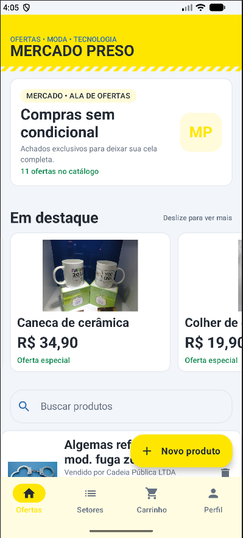
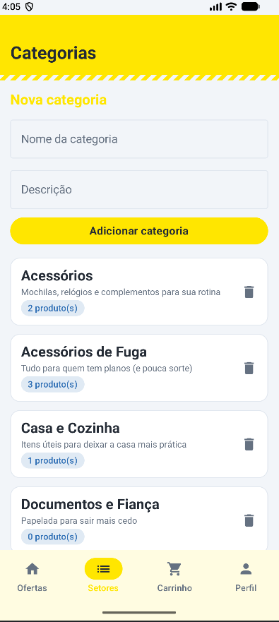
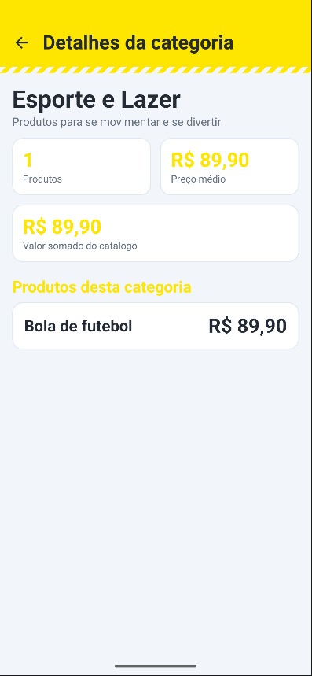
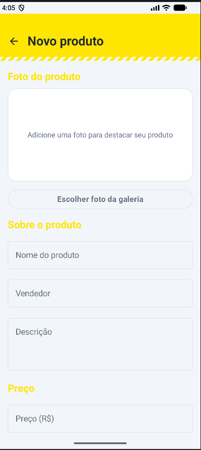
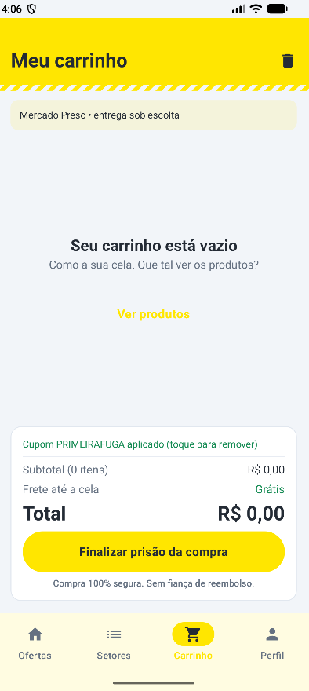
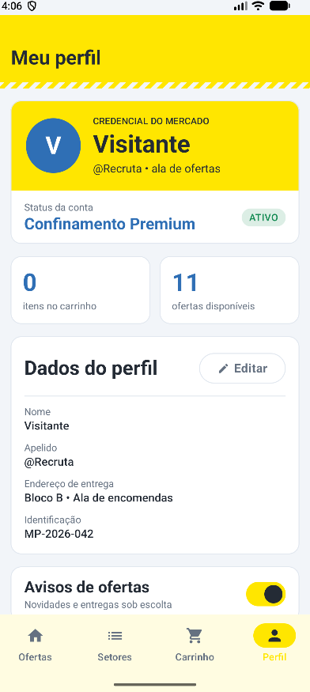
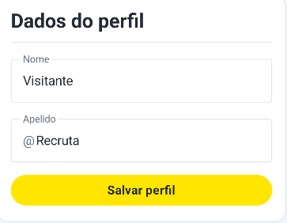

# Mercado Preso — Trabalho 3

Aplicativo Android de marketplace em Kotlin e Jetpack Compose. O tema é uma paródia de comércio online; o catálogo inclui tecnologia, moda, casa, papelaria e esporte. Produtos e categorias são armazenados localmente com Room/SQLite.

**Integrantes registrados no projeto:** Eduardo Alan e Francisco Caninde.

## Como abrir e executar

1. Abra esta pasta no Android Studio e aguarde a sincronização do Gradle.
2. Selecione um emulador ou conecte um aparelho Android.
3. Pressione **Run** para instalar e abrir o app.

Para gerar o APK de depuração no Windows, execute no terminal do Android Studio:

```powershell
.\gradlew.bat assembleDebug
```

O APK é gerado em `app/build/outputs/apk/debug/app-debug.apk`. A compilação de depuração foi concluída com sucesso em 26/10/2026. Essa confirmação é da compilação; o teste de persistência em aparelho/emulador precisa ser demonstrado separadamente, na seção de evidências.

## O que mudou desde o Trabalho 2

No Trabalho 2, os produtos e as categorias eram mantidos em listas observadas pelo Compose (`mutableStateListOf`), então esses dados não eram uma fonte persistente. No Trabalho 3, essas mesmas listas de apresentação são preenchidas a partir do Room e as operações de cadastro, edição e remoção escrevem no banco local. Ao fechar e reabrir o app, os registros devem ser carregados novamente do SQLite.

A navegação usa `NavHost`. As telas de detalhe recebem o ID do item pela rota e consultam o banco. O catálogo também ganhou categorias variadas, imagens de demonstração e seleção de foto da galeria ao cadastrar um produto. A foto selecionada é copiada para o armazenamento interno do app e o caminho fica salvo no registro.

O carrinho e o estado do pedido continuam em memória; não fazem parte das entidades persistidas deste trabalho.

## Entidades, campos e DAOs

### `Produto` — tabela `produtos`

- `id`: chave primária inteira, autogerada.
- `nome` e `vendedor`: identificação do item e de quem vende.
- `precoOriginal` e `preco`: cálculo e apresentação de desconto.
- `categoriaId`: ID da categoria associada ao produto.
- `descricao`: informações mostradas no detalhe.
- `imagemLocal`: caminho opcional da foto escolhida pelo usuário. É nulo para os produtos sem foto personalizada.

### `Categoria` — tabela `categorias`

- `id`: chave primária inteira, autogerada.
- `nome`: nome exibido no catálogo e nos filtros.
- `descricao`: explicação da categoria.

Esses campos cobrem as informações usadas nos formulários, nas listas, no detalhe e na relação entre produto e categoria. `categoriaId` é mantido no produto para identificar sua categoria.

### Consultas e operações

`ProdutoDao` e `CategoriaDao` têm métodos `suspend` para inserir, listar, atualizar e excluir. As listas são ordenadas pelo nome. Ambos também têm busca por ID, usada pelas respectivas telas de detalhe:

- Produtos: `SELECT * FROM produtos ORDER BY nome` e busca por `id`.
- Categorias: `SELECT * FROM categorias ORDER BY nome` e busca por `id`.

A busca por ID foi escolhida porque a navegação passa o identificador do item, em vez de carregar e transportar o objeto inteiro entre telas.

### Banco e migração

`AppDatabase` reúne as duas entidades e expõe os DAOs por um Singleton (`companion object`, `@Volatile` e `synchronized`). A versão atual é **2**. A migração `1 → 2` acrescenta a coluna anulável `imagemLocal` com valor padrão nulo, preservando os produtos que já estavam no banco.

As operações do DAO são executadas em `Dispatchers.IO`. A classe `LojaState` atualiza as listas observadas pelo Compose após as alterações no banco. As chamadas de leitura são iniciadas quando as telas de lista abrem; as telas de detalhe buscam o registro pelo ID recebido.

## Fluxos disponíveis

- **Produtos:** lista, busca, destaques em carrossel, cadastro, remoção e acesso ao detalhe.
- **Cadastro de produto:** nome, vendedor, descrição, preços, categoria e foto opcional selecionada da galeria.
- **Detalhe do produto:** preços, desconto, categoria, opções de compra e edição persistente do preço.
- **Categorias:** lista, cadastro, remoção quando não há produtos associados e detalhes com produtos daquela categoria.
- **Carrinho e pedido:** quantidade, subtotal, cupom, finalização e acompanhamento simulado. Esses dados são temporários em memória.

Os produtos e categorias de demonstração são incluídos apenas quando não há um registro com o mesmo nome. O app não substitui os dados existentes durante a inicialização.

## Dificuldades encontradas e decisões

Durante a integração, o Android Studio mostrou referências de Room não resolvidas enquanto as dependências e o processador KSP ainda não estavam sincronizados. Também surgiram erros de geração KSP/Kotlin, referências a propriedades delegadas e incompatibilidades entre valores anuláveis e não anuláveis. As correções foram configurar `room-runtime`, `room-ktx` e `room-compiler` com KSP, alinhar a configuração Gradle usada pelo Kotlin integrado do Android, guardar propriedades delegadas em variáveis locais quando necessário e tratar o resultado nulo da busca por ID antes de acessar o produto. Ao final, `assembleDebug` compilou com sucesso.

A principal decisão de persistência foi manter o estado observável que a interface Compose já usa, mas fazer do Room a origem dos produtos e categorias. A edição de preço consulta o registro pelo ID e usa `@Update`, preservando os demais campos. A foto é salva como arquivo privado do app e seu caminho é armazenado em `imagemLocal`; assim, não é necessário guardar uma imagem grande diretamente no SQLite nem depender de uma permissão temporária da galeria.

O histórico do projeto não identifica qual integrante teve cada dificuldade individual. Para responder com precisão à pergunta da atividade sobre a experiência de cada pessoa, os integrantes devem acrescentar aqui um exemplo real contado por eles, sem atribuir experiências que não foram registradas.

## Capturas da versão atual e evidências de execução

As capturas abaixo mostram a versão atual do app e foram adicionadas ao repositório em `evidencias/`. As imagens antigas mantidas em `prints/` são registros de versões anteriores do projeto.

<table>
  <tr>
    <td align="center"><strong>Tela inicial e ofertas em destaque</strong><br></td>
    <td align="center"><strong>Categorias</strong><br></td>
  </tr>
  <tr>
    <td align="center"><strong>Detalhe da categoria</strong><br></td>
    <td align="center"><strong>Cadastro de produto e escolha de foto</strong><br></td>
  </tr>
  <tr>
    <td align="center"><strong>Carrinho</strong><br></td>
    <td align="center"><strong>Perfil</strong><br></td>
  </tr>
  <tr>
    <td align="center"><strong>Editar dados do perfil</strong><br></td>
    <td align="center"></td>
  </tr>
</table>

As capturas documentam telas e formulários, mas não comprovam sozinhas que as alterações sobrevivem ao encerramento do aplicativo. Para completar essa evidência:

1. Grave um vídeo curto criando um produto, editando seu preço e removendo-o.
2. Grave outro vídeo cadastrando um produto com um nome fácil de reconhecer, fechando completamente o app, abrindo-o novamente e mostrando que o produto continua na lista.
3. Salve os arquivos nesta pasta, por exemplo `evidencias/crud.mp4` e `evidencias/persistencia.mp4`, ou substitua os itens abaixo por links acessíveis.

- Vídeo CRUD: **pendente de gravação**.
- Vídeo fechando e reabrindo o app: **pendente de gravação**.

A apresentação em sala também deve demonstrar ao vivo adicionar, editar, remover e fechar/reabrir o app.

## Créditos das fotos do catálogo

As imagens abaixo são fotos de referência usadas nos produtos de demonstração. Os arquivos estão em `app/src/main/res/drawable/`.

- **Algemas** (`product_algemas.jpg`): Klaus with K, [Handcuffs01 2003-06-02](https://commons.wikimedia.org/wiki/File:Handcuffs01_2003-06-02.jpg), [CC BY-SA 3.0](https://creativecommons.org/licenses/by-sa/3.0/).
- **Colher** (`product_colher.jpg`): Janakiraman janaki, [Stainless steel spoon](https://commons.wikimedia.org/wiki/File:Stainless_steel_spoon.jpg), [CC BY-SA 4.0](https://creativecommons.org/licenses/by-sa/4.0/).
- **Celular** (`product_celular.jpg`): Ka Kit Pang, [Smart-Phone.jpg](https://commons.wikimedia.org/wiki/File:Smart-Phone.jpg), [CC BY-SA 4.0](https://creativecommons.org/licenses/by-sa/4.0/).
- **Tênis** (`product_tenis.jpg`): Jesse Millan, [Sneaker.jpg](https://commons.wikimedia.org/wiki/File:Sneaker.jpg), [CC BY 2.0](https://creativecommons.org/licenses/by/2.0/).
- **Caneca** (`product_caneca.jpg`): NNU-11-Zaclee, [Ceramic mug.jpg](https://commons.wikimedia.org/wiki/File:Ceramic_mug.jpg), [CC BY-SA 3.0](https://creativecommons.org/licenses/by-sa/3.0/).
- **Caderno** (`product_caderno.jpg`): Mattes, [Paper notebooks.jpg](https://commons.wikimedia.org/wiki/File:Paper_notebooks.jpg), domínio público conforme a página do arquivo.
- **Bola** (`product_bola.jpg`): Petey21, [Soccer ball on ground.jpg](https://commons.wikimedia.org/wiki/File:Soccer_ball_on_ground.jpg), [CC0 1.0](https://creativecommons.org/publicdomain/zero/1.0/).
- **Fone de ouvido** (`product_fone.jpg`): Atorero (Alexander Kozlov), [Headphones.jpg](https://commons.wikimedia.org/wiki/File:Headphones.jpg), [CC BY-SA 3.0](https://creativecommons.org/licenses/by-sa/3.0/).
- **Mochila** (`product_mochila.jpg`): Wikisafar, [Backpack-1.jpg](https://commons.wikimedia.org/wiki/File:Backpack-1.jpg), [CC BY-SA 4.0](https://creativecommons.org/licenses/by-sa/4.0/).
- **Relógio** (`product_relogio.jpg`): J.Doniyorovich, [Wrist watchs.jpg](https://commons.wikimedia.org/wiki/File:Wrist_watchs.jpg), [CC0 1.0](https://creativecommons.org/publicdomain/zero/1.0/).

As fotos foram redimensionadas para o app. Créditos e licenças foram registrados para cada arquivo; a foto escolhida no cadastro pelo usuário é fornecida por ele.

## Checklist de entrega

- [x] Dependências Room e KSP configuradas.
- [x] Duas entidades com chave primária autogerada.
- [x] Dois DAOs com operações básicas `suspend` e consultas filtradas por ID.
- [x] `AppDatabase` Singleton com migração para a coluna da foto.
- [x] Listas e detalhes consultam o banco; cadastro, edição de preço e remoção persistem.
- [x] Projeto compila com `assembleDebug`.
- [ ] Executar e gravar o CRUD no aparelho/emulador.
- [ ] Gravar o teste de fechar e reabrir o app com os dados preservados.
- [x] Adicionar capturas das telas atuais em `evidencias/`.
- [ ] Confirmar com o trio o relato individual de dificuldade e incluí-lo acima.
- [ ] Confirmar que o remoto GitHub é o repositório novo exigido pela atividade e revisar a entrega no Blackboard.
