# Mercado Preso — Trabalho 4

Aplicativo Android de marketplace em Kotlin e Jetpack Compose. O tema é uma paródia de comércio online; o catálogo inclui tecnologia, moda, casa, papelaria e esporte. Produtos e categorias são armazenados localmente com Room/SQLite.

**Integrantes registrados no projeto:** Eduardo Alan e Francisco Caninde.

## Como abrir e executar

1. Abra esta pasta no Android Studio e aguarde a sincronização do Gradle.
2. Selecione um emulador ou conecte um aparelho Android.
3. Pressione **Run** para instalar e abrir o app.

Para gerar o APK de depuração no Windows, execute no terminal do Android Studio:

```powershell
.\gradlew.bat assembleDebug
```

O APK é gerado em `app/build/outputs/apk/debug/app-debug.apk`. A compilação da versão anterior foi concluída em 26/10/2026. A compilação da Parte 4 ainda precisa ser confirmada no Android Studio, e o teste de persistência em aparelho/emulador deve ser demonstrado separadamente.

## O que mudou desde o Trabalho 2

No Trabalho 2, o aplicativo já tinha navegação e telas de produtos, categorias, detalhes e carrinho, mas os dados ficavam em listas em memória (`mutableStateListOf`) e se perdiam ao encerrar o app. A aparência também era mais simples: fundo escuro, cartões compactos e poucos produtos de demonstração.

No Trabalho 3, além de migrar produtos e categorias para o Room, **reformulamos a aparência de todo o aplicativo**. Atualizamos cores, cartões, cabeçalhos, navegação e formulários; criamos uma identidade visual amarela para o Mercado Preso; ampliamos o catálogo com tecnologia, moda, casa, papelaria e esporte; adicionamos fotos aos produtos, carrossel de destaques e uma tela de perfil. O cadastro também permite escolher uma foto da galeria e mantê-la salva no dispositivo.

As capturas abaixo foram recuperadas do repositório anterior `Eduualan/Mercadopreso` (branch `master`) e mostram o aplicativo antes da reformulação. Elas foram copiadas para `evidencias/trabalho2/` para manter a comparação junto deste projeto. As capturas da versão atual estão mais adiante neste README, na seção de evidências.

<table>
  <tr>
    <td align="center"><strong>Lista de produtos — antes</strong><br>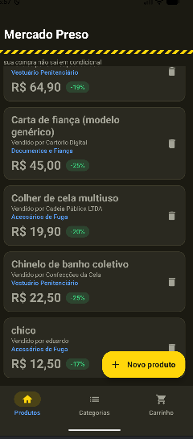</td>
    <td align="center"><strong>Categorias — antes</strong><br>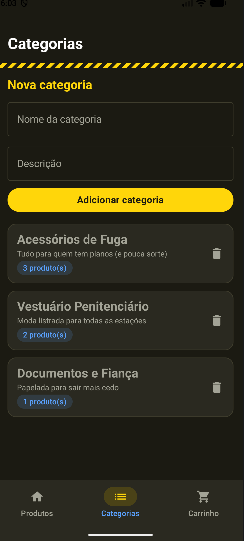</td>
  </tr>
  <tr>
    <td align="center"><strong>Detalhe do produto — antes</strong><br>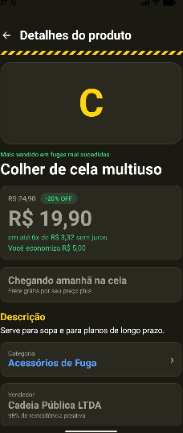</td>
    <td align="center"><strong>Carrinho — antes</strong><br>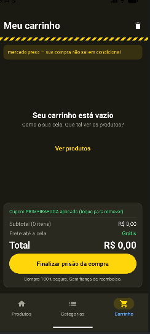</td>
  </tr>
</table>

No Trabalho 3, os dados persistidos eram coordenados pela classe de estado da loja. Na Parte 4, a interface passou a observar os ViewModels e os repositórios passaram a encapsular o acesso ao Room. O carrinho e o estado do pedido continuam em memória e não fazem parte das entidades persistidas.


## Parte 4 — organização em camadas e estado da interface

A Parte 4 reorganiza o mesmo aplicativo do Trabalho 3. Mantivemos as telas e as operações de catálogo, categorias, carrinho e perfil; o objetivo desta etapa foi separar responsabilidades e fazer a interface observar estados publicados pelos ViewModels.

### Como dividimos os pacotes

A divisão foi feita pelo tipo de responsabilidade de cada arquivo:

- `ui/` contém telas e componentes Compose. As telas desenham os dados recebidos e chamam ações dos ViewModels; não executam consultas ao Room.
  - `ProdutosScreen.kt`: catálogo e busca.
  - `ProdutoDestaques.kt`: carrossel e cálculo de desconto.
  - `ProdutoDetalheScreen.kt`: detalhe, edição de preço e ações de compra.
  - `CadastroProdutoScreen.kt`: formulário e escolha de foto.
  - `ProdutoImage.kt`: carregamento e exibição das fotos.
- `data/local/` contém o banco Room, DAOs e entidades. As entidades de negócio `Produto` e `Categoria` representam as tabelas do catálogo. `EstadoCatalogo` guarda apenas a marca técnica da carga inicial.
- `data/repository/` contém `ProdutoRepository`, `CategoriaRepository` e `EstadoCatalogoRepository`, que encapsulam o acesso aos DAOs. `CatalogoInicialRepository` coordena a carga de demonstração uma única vez.
- `viewmodel/` contém os ViewModels, seus `UiState` e as factories que recebem os repositórios na criação.
- `data/MercadoPresoContainer.kt` monta o banco e fornece as dependências para a aplicação.

Essa divisão deixa a tela dependente do estado e das ações do ViewModel; o ViewModel depende dos repositórios; e os repositórios encapsulam o acesso aos DAOs. Assim, uma futura troca do Room por uma API pode ser concentrada nos repositórios, sem colocar consultas ou detalhes do banco nas telas.

### O que o Repository resolve

Antes, a camada de interface e o estado da loja coordenavam consultas e alterações diretamente ligadas ao banco. Agora `ProdutoRepository` e `CategoriaRepository` oferecem operações como listar, inserir, atualizar e remover. Os ViewModels usam esses métodos sem precisar conhecer as anotações, consultas SQL ou DAOs do Room. O `EstadoCatalogoRepository` aplica a mesma regra à marca de carga inicial.

Além de separar responsabilidades, o Repository é o ponto de adaptação da origem dos dados: se os produtos passarem a vir de uma API, a implementação do repositório pode mudar mantendo os contratos usados pelo ViewModel.

### UiState: dados de cada área e motivo dos campos

Os estados reúnem os dados que cada tela precisa para se desenhar. A tela coleta o estado com `collectAsState()` e chama métodos do ViewModel quando há interação.

- **Produtos (`ProdutoUiState`)**: lista de produtos e categorias, produto selecionado, texto de busca, campos do formulário, categoria selecionada, caminho da foto, preço em edição, indicadores de carregamento e mensagem. Esses campos atendem à listagem, cadastro, detalhe e feedback sem espalhar o estado por várias variáveis `remember`.
- **Categorias (`CategoriaUiState`)**: lista de categorias e produtos, categoria selecionada, produtos daquela categoria, nome e descrição do formulário, carregamento e mensagem. A tela de detalhe usa os mesmos dados observados para mostrar a categoria e os produtos relacionados.
- **Carrinho (`CarrinhoUiState`)**: itens com quantidade e seleção, cupom, dados do último pedido e etapa de acompanhamento. Subtotal, desconto, total e quantidade são derivados desses dados para evitar manter cópias que poderiam ficar divergentes.
- **Perfil (`PerfilUiState`)**: nome, apelido, modo de edição, avisos, contagem do carrinho e das ofertas, e mensagem de feedback. Isso concentra o que a tela de perfil exibe e edita.

`ProdutoViewModel` e `CategoriaViewModel` observam os `Flow` dos repositórios dentro de `viewModelScope` e publicam alterações em `_uiState`, privado, expondo `uiState` somente para leitura como `StateFlow`. Carrinho e perfil também usam estados próprios para suas interações locais.

### Fluxo do catálogo e decisões de dados

`ProdutoDao.buscarTodos()` e `CategoriaDao.buscarTodos()` retornam `Flow<List<T>>`. O Room emite os dados novamente quando uma linha muda; assim, a lista observada pela interface se atualiza após inserir, alterar ou remover, sem um `LaunchedEffect` para buscar tudo manualmente.

Para abrir um detalhe, a navegação passa o ID do item. O ViewModel observa esse registro pelo Repository e publica o resultado no estado. A foto escolhida no cadastro é copiada para o armazenamento privado do app pelo repositório de produtos; o caminho fica em `imagemLocal`.

A classe `EstadoCatalogo` e sua tabela existem para impedir que produtos ou categorias apagados reapareçam ao abrir ou girar o app. Bancos antigos são marcados pela migração `2 → 3`; uma instalação nova registra a marca depois de inserir o catálogo inicial. Essa tabela é técnica e não representa uma nova função visível ao usuário.

## Entidades, campos e DAOs

### `Produto` — tabela `produtos`

- `id`: chave primária inteira, autogerada.
- `nome` e `vendedor`: identificação do item e de quem vende.
- `precoOriginal` e `preco`: cálculo e apresentação de desconto.
- `categoriaId`: ID da categoria associada ao produto.
- `descricao`: informações mostradas no detalhe.
- `imagemLocal`: caminho opcional da foto escolhida pelo usuário. É nulo para os produtos sem foto personalizada.

### `Categoria` — tabela `categorias`

- `id`: chave primária inteira, autogerada.
- `nome`: nome exibido no catálogo e nos filtros.
- `descricao`: explicação da categoria.

Esses campos cobrem as informações usadas nos formulários, nas listas, no detalhe e na relação entre produto e categoria. `categoriaId` é mantido no produto para identificar sua categoria.

### Consultas e operações

`ProdutoDao` e `CategoriaDao` usam métodos `suspend` para inserir, atualizar, excluir e buscar um item pelo ID. `buscarTodos()` não é `suspend`: retorna `Flow<List<T>>`. As listas são ordenadas pelo nome:

- Produtos: `SELECT * FROM produtos ORDER BY nome` e busca por `id`.
- Categorias: `SELECT * FROM categorias ORDER BY nome` e busca por `id`.

A busca por ID foi escolhida porque a navegação passa o identificador do item, em vez de carregar e transportar o objeto inteiro entre telas.

### Banco e migração

`AppDatabase` reúne as entidades de produto e categoria, além do controle técnico da carga inicial, e expõe os DAOs por um Singleton (`companion object`, `@Volatile` e `synchronized`). A versão atual é **3**. A migração `1 → 2` acrescenta a coluna anulável `imagemLocal`; a migração `2 → 3` cria a tabela `estado_catalogo` e marca os bancos existentes como já inicializados, para que exclusões do usuário não sejam desfeitas. Em uma instalação nova, essa marca é gravada junto com a carga inicial.

As telas acompanham os dados por `StateFlow` nos ViewModels. A camada de repositório encapsula as chamadas aos DAOs; as consultas do Room emitem `Flow`, e a interface atualiza conforme o banco muda.

## Fluxos disponíveis

- **Produtos:** lista, busca, destaques em carrossel, cadastro, remoção e acesso ao detalhe.
- **Cadastro de produto:** nome, vendedor, descrição, preços, categoria e foto opcional selecionada da galeria.
- **Detalhe do produto:** preços, desconto, categoria, opções de compra e edição persistente do preço.
- **Categorias:** lista, cadastro, remoção quando não há produtos associados e detalhes com produtos daquela categoria.
- **Carrinho e pedido:** quantidade, subtotal, cupom, finalização e acompanhamento simulado. Esses dados são temporários em memória.

Produtos e categorias de demonstração são inseridos uma única vez em uma instalação nova. A tabela `estado_catalogo` registra que a carga inicial foi feita; assim, produtos ou categorias apagados pelo usuário não voltam quando o app é reaberto. Bancos existentes recebem essa marca na migração `2 → 3`.

## Dificuldades encontradas e como resolvemos

Durante o desenvolvimento apareceram dificuldades tanto na integração com Room quanto na reorganização da Parte 4:

1. **Room e KSP no Gradle:** no início, o Android Studio mostrava imports Room não resolvidos e erros no processamento KSP. Conferimos as dependências do Room e do processador, o plugin aplicado e a configuração do Kotlin no Gradle; depois da correção, a sincronização e a compilação daquela versão avançaram.
2. **Separar a tela de produtos:** ao mover o formulário para `CadastroProdutoScreen.kt`, o editor apontou `rememberScrollState` como referência não resolvida. A lista de problemas indicou o arquivo e a linha; faltava importar a função. O import foi adicionado.
3. **Itens fixos voltando após exclusão ou rotação:** a carga inicial inseria novamente qualquer produto ou categoria que não encontrava. Criamos um registro persistente da carga inicial e uma migração para bancos existentes. A rotina agora só semeia uma instalação nova e grava a marca na mesma transação.
4. **Dados que podem não existir:** uma busca por ID pode retornar `null`, e o Kotlin não permite usar esse resultado como se sempre houvesse um item. As telas verificam a ausência antes de desenhar o detalhe e a edição de preço.

Esses pontos foram resolvidos no código e registrados como dificuldades técnicas do projeto. O grupo tem dois integrantes: Eduardo Alan e Francisco Caninde. Os relatos individuais de dificuldade serão escritos pelos próprios integrantes antes da entrega, para que cada um explique com suas palavras o que enfrentou e como resolveu.

## Capturas da versão atual e evidências de execução

As capturas abaixo mostram a versão atual do app e foram adicionadas ao repositório em `evidencias/`. As imagens antigas mantidas em `prints/` são registros de versões anteriores do projeto.

<table>
  <tr>
    <td align="center"><strong>Tela inicial e ofertas em destaque</strong><br>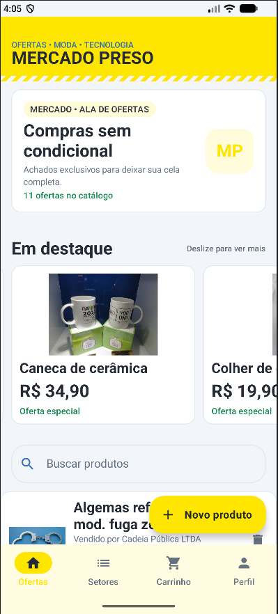</td>
    <td align="center"><strong>Categorias</strong><br>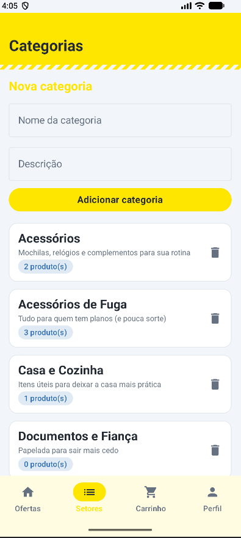</td>
  </tr>
  <tr>
    <td align="center"><strong>Detalhe da categoria</strong><br>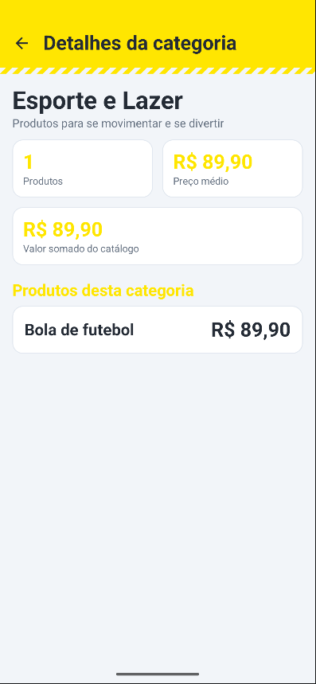</td>
    <td align="center"><strong>Cadastro de produto e escolha de foto</strong><br>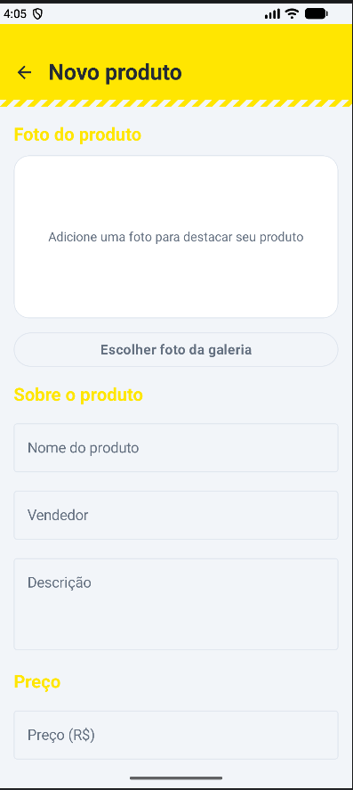</td>
  </tr>
  <tr>
    <td align="center"><strong>Carrinho</strong><br>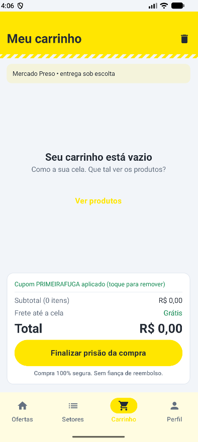</td>
    <td align="center"><strong>Perfil</strong><br>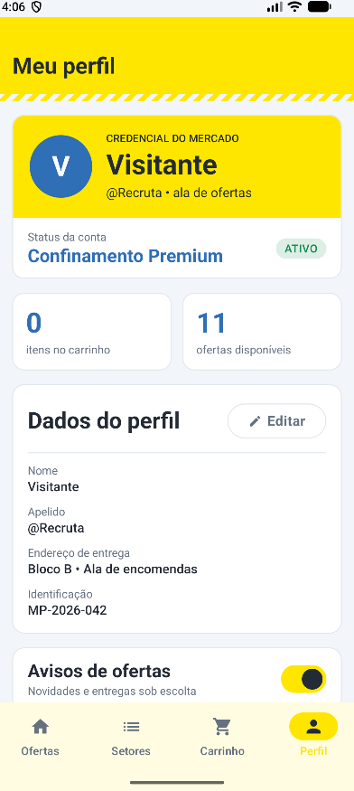</td>
  </tr>
  <tr>
    <td align="center"><strong>Editar dados do perfil</strong><br>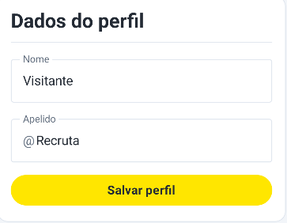</td>
    <td align="center"></td>
  </tr>
</table>


### Vídeo de CRUD e demonstração

[](https://youtu.be/7kYqOw9_61s)

[Assistir ao vídeo no YouTube](https://youtu.be/7kYqOw9_61s) — demonstração do aplicativo e das operações de CRUD. O vídeo já publicado documenta a versão anterior à reorganização. Para comprovar a Parte 4, gravem uma nova demonstração após compilar e testar esta versão, mostrando cadastro, edição, remoção, rotação da tela e reabertura sem os itens apagados.

A apresentação em sala também deve demonstrar ao vivo adicionar, editar, remover e fechar/reabrir o app.

## Créditos das fotos do catálogo

As imagens abaixo são fotos de referência usadas nos produtos de demonstração. Os arquivos estão em `app/src/main/res/drawable/`.

- **Algemas** (`product_algemas.jpg`): Klaus with K, [Handcuffs01 2003-06-02](https://commons.wikimedia.org/wiki/File:Handcuffs01_2003-06-02.jpg), [CC BY-SA 3.0](https://creativecommons.org/licenses/by-sa/3.0/).
- **Colher** (`product_colher.jpg`): Janakiraman janaki, [Stainless steel spoon](https://commons.wikimedia.org/wiki/File:Stainless_steel_spoon.jpg), [CC BY-SA 4.0](https://creativecommons.org/licenses/by-sa/4.0/).
- **Celular** (`product_celular.jpg`): Ka Kit Pang, [Smart-Phone.jpg](https://commons.wikimedia.org/wiki/File:Smart-Phone.jpg), [CC BY-SA 4.0](https://creativecommons.org/licenses/by-sa/4.0/).
- **Tênis** (`product_tenis.jpg`): Jesse Millan, [Sneaker.jpg](https://commons.wikimedia.org/wiki/File:Sneaker.jpg), [CC BY 2.0](https://creativecommons.org/licenses/by/2.0/).
- **Caneca** (`product_caneca.jpg`): NNU-11-Zaclee, [Ceramic mug.jpg](https://commons.wikimedia.org/wiki/File:Ceramic_mug.jpg), [CC BY-SA 3.0](https://creativecommons.org/licenses/by-sa/3.0/).
- **Caderno** (`product_caderno.jpg`): Mattes, [Paper notebooks.jpg](https://commons.wikimedia.org/wiki/File:Paper_notebooks.jpg), domínio público conforme a página do arquivo.
- **Bola** (`product_bola.jpg`): Petey21, [Soccer ball on ground.jpg](https://commons.wikimedia.org/wiki/File:Soccer_ball_on_ground.jpg), [CC0 1.0](https://creativecommons.org/publicdomain/zero/1.0/).
- **Fone de ouvido** (`product_fone.jpg`): Atorero (Alexander Kozlov), [Headphones.jpg](https://commons.wikimedia.org/wiki/File:Headphones.jpg), [CC BY-SA 3.0](https://creativecommons.org/licenses/by-sa/3.0/).
- **Mochila** (`product_mochila.jpg`): Wikisafar, [Backpack-1.jpg](https://commons.wikimedia.org/wiki/File:Backpack-1.jpg), [CC BY-SA 4.0](https://creativecommons.org/licenses/by-sa/4.0/).
- **Relógio** (`product_relogio.jpg`): J.Doniyorovich, [Wrist watchs.jpg](https://commons.wikimedia.org/wiki/File:Wrist_watchs.jpg), [CC0 1.0](https://creativecommons.org/publicdomain/zero/1.0/).

As fotos foram redimensionadas para o app. Créditos e licenças foram registrados para cada arquivo; a foto escolhida no cadastro pelo usuário é fornecida por ele.

## Checklist de entrega

- [x] Dependências Room e KSP configuradas.
- [x] Duas entidades com chave primária autogerada.
- [x] Dois DAOs com operações `suspend`, consultas por ID e listas observáveis em `Flow<List<T>>`.
- [x] `AppDatabase` Singleton com migrações da coluna da foto e do controle da carga inicial do catálogo.
- [x] Catálogo demonstrativo semeado uma única vez, sem repor itens apagados.
- [x] Listas e detalhes consultam o banco; cadastro, edição de preço e remoção persistem.
- [ ] Projeto compila com `assembleDebug` nesta versão da Parte 4.
- [ ] Executar e gravar o CRUD no aparelho/emulador.
- [ ] Gravar o teste de fechar e reabrir o app com os dados preservados.
- [ ] Confirmar no aparelho/emulador que exclusões continuam aplicadas após girar a tela e reabrir o app.
- [x] Adicionar capturas das telas atuais em `evidencias/`.
- [x] Organizar os pacotes e criar repositórios, ViewModels com UiState e factories para a Parte 4.
- [x] Documentar a organização e as decisões da Parte 4 no README.
- [x] Registrar duas dificuldades técnicas do projeto e como foram resolvidas.
- [ ] Confirmar que a branch e o remoto GitHub usados são o mesmo repositório do Trabalho 3 e revisar a entrega no Blackboard.
- [ ] Acrescentar os relatos reais de dificuldade de Eduardo Alan e Francisco Caninde antes da entrega.
